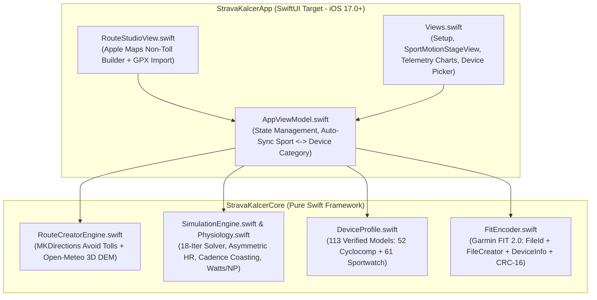

# Rancangan Update Aplikasi iOS (Strava Kalcer iOS v2.0 Blueprint)

Dokumen ini berisi rancangan teknis lengkap (*implementation blueprint*) untuk memutakhirkan aplikasi **Strava Kalcer iOS (`Swift 5.0 / SwiftUI / iOS 17.0+`)** agar 100% setara dengan seluruh pembaruan terbaru pada **Strava Kalcer Web v2.0**.

---

## 1. Ringkasan Pembaruan Utama (Target iOS `v2.0`)

| No | Modul / Fitur | Masalah pada iOS `v1.0` | Spesifikasi Baru pada iOS `v2.0` | Berkas Target di `ios/` |
| :--- | :--- | :--- | :--- | :--- |
| **1** | **Fix Nama Device di Strava (`FitEncoder`)** | Strava hanya menampilkan `"COROS PACE"` atau mengabaikan nama model spesifik karena `product_name` hanya berisi `modelName` tanpa `SourceType.LOCAL` & `FileCreatorMesg`. | Menulis `fitProductName` (`"COROS PACE 4"`, `"COROS PACE 3"`, dll.) pada Field `8` (`FileIdMesg`) & Field `27` (`DeviceInfoMesg`), menambahkan Field `25` (`source_type = 5` / `local`), serta menambahkan `FileCreatorMesg` (Global Mesg `49`). | `ios/Sources/StravaKalcerCore/FitEncoder.swift` |
| **2** | **Katalog 113 Alat Ukur Resmi (`CYCLOCOMP` vs `SPORTWATCH`)** | Hanya memiliki ~43 model dan beberapa Manufacturer/Product ID belum sinkron (misal COROS tertulis `281` bukan `294`). | Memperbarui `DeviceProfileRegistry` menjadi **113 model resmi** (**52 `CYCLOCOMP`** khusus Sepeda + **61 `SPORTWATCH`** khusus Lari & Multisport), termasuk **COROS PACE 4 (`294/806`)**, **COROS PACE 3 (`294/804`)**, **COROS NOMAD (`294/861`)**, **Forerunner 970 (`1/4565`)**, **Wahoo ROAM 3 (`32/54`)**, dan **Edge MTB (`1/4540`)**. | `ios/Sources/StravaKalcerCore/DeviceProfile.swift` |
| **3** | **Pemisahan Tegas Alat Ukur Berdasarkan Olahraga** | Pengguna masih bisa tidak sengaja memakai Cyclocomp saat simulasi Lari. | Saat `sport == .cycling` otomatis memilih tab `CYCLOCOMP` (default: `Garmin Edge 1040 Solar`). Saat `sport == .running` otomatis mengunci/memilih `SPORTWATCH` (default: `COROS PACE 4` / `COROS PACE 3`). | `ios/Sources/StravaKalcerApp/AppViewModel.swift` & `Views.swift` |
| **4** | **Route Studio Non-Tol + Elevasi 3D DEM Satelit** | Elevasi rute yang digambar di peta masih menggunakan gelombang sintetis sinusoidal. | Tetap menggunakan `MKDirections` (`transportType = .automobile`, `tollPreference = .avoid`) untuk jalan raya bebas tol, ditambah pengambilan elevasi 3D asli dari **Open-Meteo DEM API** (`https://api.open-meteo.com/v1/elevation`) dengan *fallback* sintetis jika offline. | `ios/Sources/StravaKalcerCore/RouteCreatorEngine.swift` |
| **5** | **Animasi Vektor Pesepeda & Pelari + Penyederhanaan Teks UI** | Tampilan kartu konfigurasi masih padat dengan deskripsi teks panjang. | Menambahkan komponen `SportMotionStageView` (animasi vektor SwiftUI `Canvas` / `Shape` pesepeda *aero road* & pelari maraton) serta menyederhanakan seluruh label teks agar ringkas dan profesional. | `ios/Sources/StravaKalcerApp/Views.swift` |

---

## 2. Arsitektur Modul iOS (`ios/Sources/`)



---

## 3. Rincian Perubahan Kode per Berkas

### A. `ios/Sources/StravaKalcerCore/FitEncoder.swift`
Pastikan struktur biner `.FIT` menyertakan 3 elemen kunci agar Strava mengenali model perangkat secara presisi:
1. **`FileIdMesg` (Global Mesg `0`, Local `0`)**:
   - Field `0` (`type`, `uint8`) = `4` (Activity)
   - Field `1` (`manufacturer`, `uint16`) = `device.manufacturerId` (contoh: `294` untuk COROS, `1` untuk Garmin, `32` untuk Wahoo)
   - Field `2` (`product`, `uint16`) = `device.productNumber` (contoh: `806` untuk COROS PACE 4, `804` untuk COROS PACE 3)
   - Field `3` (`serial_number`, `uint32`) = `device.serialNumber`
   - Field `4` (`time_created`, `uint32`) = `startFitTime`
   - Field `8` (`product_name`, `string` 24-byte null-terminated UTF-8) = `device.stravaProductName` (contoh: `"COROS PACE 4\0..."`)
2. **`FileCreatorMesg` (Global Mesg `49`, Local `8`)**:
   - Field `0` (`software_version`, `uint16`) = `device.softwareVersion`
   - Field `1` (`hardware_version`, `uint8`) = `1`
3. **`DeviceInfoMesg` (Global Mesg `23`, Local `1`)**:
   - Tambahkan Field `25` (`source_type`, `enum` / `uint8`) = `5` (`SourceType.local`)
   - Pastikan Field `27` (`product_name`, `string` 24-byte) berisi `device.stravaProductName` (sama persis dengan Field `8` di `FileIdMesg`).

---

### B. `ios/Sources/StravaKalcerCore/DeviceProfile.swift`
Gunakan ID Manufaktur dan ID Produk resmi sesuai standar Garmin FIT SDK `Profile.xlsx` & Strava Hardware Registry:

| Brand | `manufacturerId` | Contoh Model & `productNumber` Resmi |Kategori |
| :--- | :---: | :--- | :--- |
| **COROS** | `294` | `PACE 4` (`806`), `PACE Pro` (`805`), `PACE 3` (`804`), `PACE 2` (`802`), `PACE` (`801`), `NOMAD` (`861`), `APEX 2 Pro` (`822`), `APEX 2` (`821`), `VERTIX 2S` (`833`), `VERTIX 2` (`832`), `DURA Solar Cyclocomp` (`851`) | `SPORTWATCH` (`801`–`861`), `CYCLOCOMP` (`851`) |
| **Garmin** | `1` | **Cyclocomp**: `Edge 1050` (`4440`), `Edge MTB` (`4540`), `Edge 1040 Solar` (`3843`), `Edge 840` (`4062`), `Edge 540` (`4061`), `Edge 830` (`3122`), `Edge 530` (`3121`), `Edge Explore 2` (`4169`)<br>**Sportwatch**: `Forerunner 970` (`4565`), `Forerunner 570` (`4570`), `Forerunner 965` (`4315`), `Forerunner 265` (`4257`), `Forerunner 165` (`4432`), `fēnix 8 AMOLED` (`4536`), `Enduro 3` (`4575`) | `CYCLOCOMP` & `SPORTWATCH` |
| **Wahoo Fitness** | `32` | **Cyclocomp**: `ELEMNT ACE` (`52`), `ELEMNT ROAM 3` (`54`), `ELEMNT BOLT 3` (`53`), `ELEMNT ROAM v2` (`47`), `ELEMNT BOLT v2` (`41`)<br>**Sportwatch**: `ELEMNT RIVAL` (`101`) | `CYCLOCOMP` & `SPORTWATCH` |
| **Hammerhead** | `289` | `Karoo 3` (`3`), `Karoo 2` (`2`), `Karoo` (`1`) | `CYCLOCOMP` |
| **Bryton** | `267` | `Rider S800` (`1908`), `Rider S510` (`1912`), `Rider S500` (`1906`), `Rider 750 SE` (`1905`), `Rider 460` (`1910`), `Rider 420` (`1901`) | `CYCLOCOMP` |
| **iGPSPORT** | `115` | `BiNavi` (`810`), `iGS800` (`800`), `iGS630S` (`631`), `iGS630` (`630`), `BSC300` (`300`), `BSC200` (`200`) | `CYCLOCOMP` |
| **Magene** | `107` | `C606` (`606`), `C506` (`506`), `C406 Pro` (`407`), `C406` (`406`) | `CYCLOCOMP` |
| **Suunto** | `23` | `Suunto Run` (`98`), `Suunto Race` (`95`), `Suunto Race S` (`96`), `Suunto Vertical` (`92`), `Suunto 9 Peak Pro` (`88`), `Suunto 5 Peak` (`85`) | `SPORTWATCH` |
| **Polar Electro** | `123` | `Vantage V3` (`210`), `Grit X2 Pro` (`225`), `Vantage M3` (`230`), `Pacer Pro` (`195`), `Pacer` (`196`) | `SPORTWATCH` |

---

### C. `ios/Sources/StravaKalcerCore/RouteCreatorEngine.swift` (Elevasi 3D Satelit)
Tambahkan fungsi `fetchReal3DElevations(coordinates:)` yang memanggil endpoint gratis **Open-Meteo Elevation API**:
```swift
public static func fetchReal3DElevations(
    for coordinates: [CLLocationCoordinate2D]
) async -> [Double]? {
    guard !coordinates.isEmpty else { return nil }
    let n = coordinates.count
    let sampleCount = min(80, n)
    var sampleIndices: [Int] = []
    for i in 0..<sampleCount {
        let idx = (n == 1) ? 0 : Int(round(Double(i) / Double(sampleCount - 1) * Double(n - 1)))
        if sampleIndices.last != idx { sampleIndices.append(idx) }
    }
    let lats = sampleIndices.map { String(format: "%.5f", coordinates[$0].latitude) }.joined(separator: ",")
    let lons = sampleIndices.map { String(format: "%.5f", coordinates[$0].longitude) }.joined(separator: ",")
    guard let url = URL(string: "https://api.open-meteo.com/v1/elevation?latitude=\(lats)&longitude=\(lons)") else {
        return nil
    }
    do {
        let (data, response) = try await URLSession.shared.data(from: url)
        guard let http = response as? HTTPURLResponse, http.statusCode == 200 else { return nil }
        struct OpenMeteoElevationResponse: Decodable { let elevation: [Double] }
        let decoded = try JSONDecoder().decode(OpenMeteoElevationResponse.self, from: data)
        guard decoded.elevation.count == sampleIndices.count else { return nil }
        var fullElevations = [Double](repeating: 0.0, count: n)
        for (sIdx, ptIdx) in sampleIndices.enumerated() {
            fullElevations[ptIdx] = decoded.elevation[sIdx]
        }
        for s in 0..<(sampleIndices.count - 1) {
            let startIdx = sampleIndices[s]
            let endIdx = sampleIndices[s + 1]
            let startEle = fullElevations[startIdx]
            let endEle = fullElevations[endIdx]
            let span = Double(endIdx - startIdx)
            if span > 1 {
                for k in (startIdx + 1)..<endIdx {
                    fullElevations[k] = startEle + ((endEle - startEle) * Double(k - startIdx)) / span
                }
            }
        }
        return fullElevations
    } catch {
        return nil
    }
}
```

---

### D. Penyederhanaan Teks UI & Animasi Vektor di `ios/Sources/StravaKalcerApp/Views.swift`
1. **Prinsip Copywriting Minimalis**:
   - Gunakan judul seksi singkat: `Route`, `Setup`, `Telemetry`, `Export .FIT`.
   - Hapus subjudul paragraf panjang pada kartu pengaturan.
   - Tampilkan informasi kartu perangkat secara ringkas:
     - Baris atas: Badge `CYCLOCOMP` (biru sian) atau `SPORTWATCH` (hijau) + `Barometer`
     - Judul: `COROS PACE 4 AMOLED`
     - Subjudul: `Strava: COROS PACE 4`
2. **Sinkronisasi Otomatis Olahraga & Kategori Alat Ukur**:
   - Pada `AppViewModel.swift`, ketika `selectedSport` berubah:
     - Jika `.cycling`: filter daftar perangkat ke `.cyclocomputer` dan pilih `garmin_edge_1040` jika perangkat sebelumnya bukan cyclocomp.
     - Jika `.running`: filter daftar perangkat ke `.runningWatch` / `.outdoorWatch` dan pilih `coros_pace_4` (atau `coros_pace_3`) jika perangkat sebelumnya adalah cyclocomp.

---

## 4. Langkah Build & Compile IPA (macOS Xcode / GitHub Actions)

### Opsi 1: Build Langsung di Mac menggunakan Xcode / Terminal
```bash
cd ios

# 1. Regenerasi file proyek Xcode jika ada penambahan file Swift baru
python3 generate_xcodeproj.py

# 2. Jalankan Unit Test / CLI Verification menggunakan Swift Package Manager
swift test
swift run StravaKalcerCLI

# 3. Build Archive untuk iOS Device (Unsigned IPA untuk Sideloadly / AltStore / TrollStore)
xcodebuild -project StravaKalcer.xcodeproj \
  -scheme StravaKalcerApp \
  -configuration Release \
  -destination "generic/platform=iOS" \
  -archivePath build/StravaKalcer.xcarchive \
  archive \
  CODE_SIGN_IDENTITY="" \
  CODE_SIGNING_REQUIRED=NO \
  CODE_SIGNING_ALLOWED=NO

# 4. Bungkus .app menjadi berkas .ipa siap install
mkdir -p build/Payload
cp -R build/StravaKalcer.xcarchive/Products/Applications/StravaKalcerApp.app build/Payload/
cd build && zip -r StravaKalcer-v2.0.0.ipa Payload && cd ..
```

### Opsi 2: Build Otomatis via GitHub Actions (Tanpa Mac)
Jika Anda melakukan *push* ke repositori GitHub, jalankan workflow macOS runner (`macos-14` / `xcodebuild`) dengan perintah di atas untuk menghasilkan *artifact* `StravaKalcer-v2.0.0.ipa` secara otomatis.
