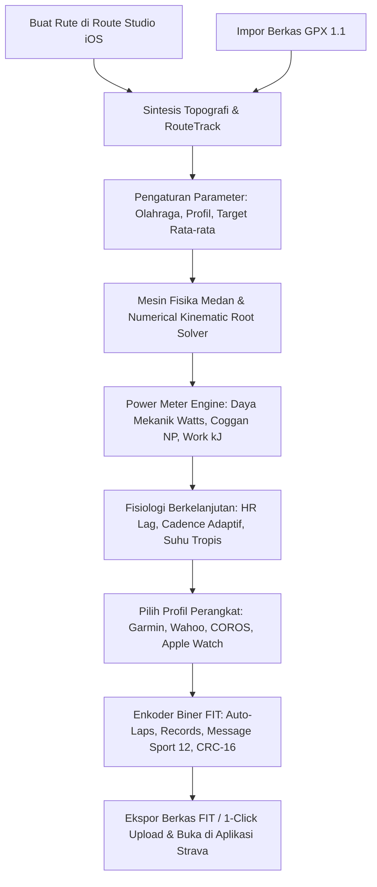

# Strava Kalcer — Native Cross-Platform (iOS & Android) Fitness Simulation & FIT Engine

[-FF5722.svg?logo=android&logoColor=white)](https://github.com/ardianrifendy/strava-kalcer/releases/latest)
[](ios/)
[](ios/)
[](ios/)
[](https://kotlinlang.org/)
[-3DDC84.svg?logo=android&logoColor=white)](https://developer.android.com/)
[](https://developer.garmin.com/fit/overview/)
[](#panduan-build--menjalankan--how-to-build--test)
[](LICENSE)

**Strava Kalcer** adalah mesin simulasi dan rekonstruksi aktivitas olahraga lintas platform (**iOS & Android**) berkinerja tinggi yang dibangun secara native menggunakan **Swift 5.0 / SwiftUI (iOS)** dan **Kotlin / Jetpack Compose (Android)**.

Berbeda dari konverter GPX tradisional yang hanya menempelkan kecepatan statis atau interval waktu acak, **Strava Kalcer** menjalankan pemodelan mekanika fisika kinetik numerik, respon kardiovaskular asimetris, dinamika daya kayuhan (*power meter*), struktur auto-lap split, serta modul pembuatan rute mandiri (**Route Studio**) untuk menghasilkan berkas resmi **Garmin FIT (`.fit`)** dan **GPX 1.1** yang 100% konsisten, realistis, dan valid saat diunggah ke Strava, Garmin Connect, maupun TrainingPeaks.

---

## Daftar Isi / Table of Contents
1. [Unduh APK Android Siap Pakai](#unduh-apk-android-siap-pakai)
2. [Perbandingan: Konverter Biasa vs Strava Kalcer](#perbandingan-konverter-biasa-vs-strava-kalcer)
3. [Arsitektur Proyek Lintas Platform](#arsitektur-proyek-lintas-platform)
4. [Alur Kerja Pipeline Simulasi](#alur-kerja-pipeline-simulasi)
5. [Fitur Unggulan Sistem](#fitur-unggulan-sistem)
   - [Route Studio & GPX Builder (iOS)](#1-route-studio--gpx-builder-ios-native)
   - [Pemodelan Fisika Sepeda & Lari](#2-pemodelan-fisika-kinetik-sepeda--lari)
   - [Fisiologi Kardiovaskular & Sensorik](#3-fisiologi-kardiovaskular--sensorik)
   - [Auto-Lap Splits & Protokol Garmin FIT](#4-auto-lap-splits--protokol-garmin-fit-100)
   - [Integrasi Strava Langsung](#5-integrasi-strava-langsung)
6. [Daftar Perangkat yang Didukung](#daftar-perangkat-yang-didukung--supported-devices)
7. [Berkas Sampel & Deliverables](#berkas-sampel--deliverables)
8. [Panduan Build & Menjalankan](#panduan-build--menjalankan--how-to-build--test)
   - [Pembangunan Proyek iOS (Xcode / devicectl)](#a-pembangunan-proyek-ios-swift-50--xcode)
   - [Pembangunan Proyek Android (Gradle / APK)](#b-pembangunan-proyek-android-kotlin--gradle)
9. [Dokumentasi Formulasi Matematika](#dokumentasi-formulasi-matematika--algorithms)
10. [Lisensi](#lisensi--license)

---

## Unduh APK Android Siap Pakai

Berkas instalasi APK Android yang sudah siap di-install (kompatibel untuk Android 8.0 Oreo ke atas / API 26+) tersedia di GitHub Releases:

| Berkas Instalasi | Versi | Ukuran | Tautan Unduh Langsung |
| :--- | :--- | :--- | :--- |
| **Strava Kalcer Android APK** | `v1.0.0` | ~21.0 MB | [**Download StravaKalcer-v1.0.0-debug.apk**](https://github.com/ardianrifendy/strava-kalcer/releases/download/v1.0.0/StravaKalcer-v1.0.0-debug.apk) |

> [!TIP]
> **Cara Instalasi di HP Android**:
> 1. Unduh file APK di atas melalui browser HP Anda.
> 2. Buka file `.apk` yang telah diunduh, lalu pilih **Install**.
> 3. Jika muncul dialog perizinan, centang *Izinkan dari sumber ini*.

---

## Perbandingan: Konverter Biasa vs Strava Kalcer

| Parameter / Fitur | Konverter GPX Standar | **Strava Kalcer Engine (iOS & Android)** |
| :--- | :--- | :--- |
| **Pembuatan Rute** | Harus mencari/membuat GPX eksternal | **Route Studio bawaan**: gambar rute jalan raya langsung di peta, generator loop otomatis, dan tombol GPS Start |
| **Profil Kecepatan** | Kecepatan konstan rata (*flatline*) | **Dinamis berbasis kontur**: menanjak melambat, turunan meluncur cepat sesuai hukum gravitasi |
| **Akselerasi** | Lompatan instan tidak realistis | **Terikat inersia fisik**: percepatan dan deselerasi bertahap (*kinematic bounds*) |
| **Power Meter (Watts)** | Tidak ada data / 0W | **Simulasi Mekanika Fisik**: aerodinamika ($C_d A$), hambatan ban ($C_{rr}$), gradien kemiringan, & Normalized Power (NP) |
| **Pembedaan Sensor Olahraga**| Semua jenis disamakan | **Akurat**: Sepeda memuat sensor pedal Rally RS200; Lari hanya memuat HRM-Pro Plus & Running Dynamics Pod |
| **Auto-Lap Splits** | 1 lap utuh / tanpa split | **Pecahan Split Otomatis**: 1 km untuk Lari, 5 km untuk Sepeda dengan statistik lap lengkap |
| **Sensor Suhu** | Tidak ada data | **Suhu Tropis Realistis**: Kurva suhu ($27^\circ\text{C} - 31^\circ\text{C}$) pada Record & Lap FIT |
| **Kalkulasi Kalori** | Kosong atau perkiraan kasar | **Beban Metabolik Fisik**: Dihitung dari kumulatif mekanis kJ & efisiensi metabolik tubuh (~24%) |
| **Detak Jantung (HR)** | Angka konstan tanpa jeda | **Model Asimetris 1st-Order**: cardiac lag saat beban naik (~12s) dan pemulihan lambat (~26s) |
| **Kadensi (Cadence)** | Flat konstan | **Adaptif**: torsi tinggi saat tanjakan, freewheel coasting ($0\text{ rpm}$) saat turunan terjal |
| **Protokol Berkas** | Sering error di platform analitik | **100% Garmin FIT Protocol**: Header, FileId, Sport Mesg 12, Session, Lap, Record, dan CRC-16 |

---

## Arsitektur Proyek Lintas Platform

Proyek dirancang dengan pemisahan modular yang bersih antara platform native Apple iOS dan Google Android:

```text
strava-kalcer
├── ios/                               # Native Apple iOS App & Core Engine
│   ├── Package.swift                  # Swift Package Manager manifest
│   ├── generate_xcodeproj.py          # Generator otomatis project Xcode (.xcodeproj)
│   ├── sample_loop.gpx                # Rute GPX bawaan perbukitan (8.9 km)
│   ├── StravaKalcer.xcodeproj/        # Proyek resmi Xcode (Target iOS 17.0+)
│   └── Sources/
│       ├── StravaKalcerCore/          # Mesin komputasi dan enkoder independen
│       │   ├── Models.swift           # Model data Track, Point, Settings, SimulationResult
│       │   ├── GeoMath.swift          # Kalkulasi geodesik Haversine, bearing, gradient smoothing
│       │   ├── GpxParser.swift        # XML Parser standar GPX 1.1
│       │   ├── RouteCreatorEngine.swift # MapKit road routing, Smart Loop, elevasi topografi, GPX export
│       │   ├── Physiology.swift       # Kardiovaskular 1st-order lag, kadensi adaptif, daya Stryd
│       │   ├── SimulationEngine.swift # Numerical kinematic root solver & terrain resistance
│       │   ├── DeviceProfile.swift    # Registri metadata Garmin, Wahoo, Hammerhead, COROS, Apple
│       │   ├── FitEncoder.swift       # Native binary encoder protokol Garmin FIT & CRC-16
│       │   └── StravaApiClient.swift  # Klien upload API Strava resmi
│       │
│       └── StravaKalcerApp/           # Antarmuka SwiftUI iOS
│           ├── Info.plist             # Konfigurasi bundle, skema URL, dan izin CoreLocation
│           ├── AppViewModel.swift     # State management berbasis Swift Observation (@Observable)
│           ├── Views.swift            # Layar Home, Parameter, Preview, dan Floating Workflow Dock
│           ├── RouteStudioView.swift  # Layar studio rute interaktif, kontrol peta, dan GPS Start
│           ├── FeedAndHistoryViews.swift # Riwayat berkas FIT dan integrasi feed
│           └── Assets.xcassets/       # App Icon dan aset grafis
│
├── core-simulation/                   # Pure Kotlin JVM library (independen dari Android UI/framework)
│   ├── gpx/                           # GPX 1.1 parser, elevation quality auditor, RouteProcessor, GeoMath
│   ├── intelligence/                  # Route intelligence (kategorisasi tanjakan/turunan, grade smoothing)
│   ├── simulation/                    # Cycling & running terrain physics, dynamic target-average root solver
│   ├── physiology/                    # Continuous HR lag, Cadence, & PowerEngine (Watts, NP, Work kJ, Calories)
│   ├── device/                        # Device profile registry (Garmin, Wahoo, COROS, Suunto, Polar, Apple Watch, dll.)
│   ├── fit/                           # Garmin FIT binary encoder & parse-back validator
│   ├── debug/                         # CSV diagnostic export & explainability reasons
│   └── sample/                        # Synthetic route generator untuk demonstrasi instan
│
└── app/                               # Android Jetpack Compose application module (Material 3 Dark Theme)
    ├── theme/                         # Athletic color palette, typography & tokens
    ├── ui/components/                 # Multi-chart canvas tersinkronisasi, route polyline map canvas
    ├── ui/screens/                    # Home, Route Review, Settings, Preview, Device Select, Export, Debug
    └── viewmodel/                     # Reactive state management berbasis Kotlin StateFlow & Coroutines
```

---

## Alur Kerja Pipeline Simulasi



1. **Pembuatan atau Impor Rute**: Buat rute baru langsung di Route Studio dengan snap-to-road dan GPS, atau impor berkas `.gpx` yang sudah ada.
2. **Audit & Rekonstruksi Elevasi**: Menghitung jarak kumulatif dan gradient kemiringan dengan penghalusan *Rolling Gaussian Window*.
3. **Pengaturan Parameter Aktivitas**: Tentukan moda olahraga (Sepeda / Lari), profil usaha (*Casual*, *Endurance*, *Tempo*, *Race*), serta target kecepatan atau pace.
4. **Simulasi Fisika Medan**: Solver menghitung profil kecepatan per detik dengan memperhitungkan gaya gravitasi, hambatan udara, dan gesekan aspal.
5. **Pemodelan Daya & Fisiologi**: Menghasilkan daya watt per detik, Normalized Power (NP Coggan), detak jantung realistis dengan jeda inersia kardiovaskular, serta kadensi dinamis.
6. **Enkoding Biner Garmin FIT**: Serialisasi pesan biner resmi lengkap dengan pemecahan lap otomatis (1 km lari / 5 km sepeda) dan CRC-16.
7. **Ekspor & Unggah**: Simpan berkas FIT lokal, bagikan via ShareSheet, atau unggah langsung ke Strava.

---

## Fitur Unggulan Sistem

### 1. Route Studio & GPX Builder (iOS Native)
- **Snap-to-Road Otomatis (`MKDirections`)**: Cukup ketuk titik persimpangan jalan di peta Apple Maps. Sistem otomatis menarik garis mengikuti jalan raya aspal nyata.
- **Mode Drive & Proteksi Hindari Jalan Tol (`tollPreference = .avoid`)**:
  Perutean sepenuhnya menggunakan mode kendaraan (`.automobile`) untuk menjamin rute melintasi jalan raya utama, dengan pemfilteran ketat `route.hasTolls == false` sehingga rute pesepeda dan pelari terhindar dari jalan tol.
- **Generator Smart Loop Otomatis**: Cukup tentukan titik awal, target jarak (misal 5 km, 10 km, 25 km, 40 km), dan arah mata angin. Algoritma dengan faktor *road tortuosity* ($\tau \approx 1.28$) secara otomatis membentuk rute memutar tertutup (*closed-loop*) kembali ke titik start.
- **Fitur GPS Start (`CoreLocation`)**: Tombol **Mulai dari Lokasi Saya (GPS Start)** memusatkan peta dan langsung menyetel titik awal rute di lokasi fisik Anda saat ini.
- **Cari Tempat (`MKLocalSearch`)**: Integrasi pencarian nama jalan, kafe, atau taman kota langsung ke dalam peta.
- **Sintesis Elevasi Topografi Alami**: Model gelombang Fourier multi-tingkat (makro, meso, mikro) untuk menghasilkan profil elevasi bergelombang alami yang realistis.
- **Ekspor Berkas GPX 1.1**: Standar XML schema Topografix yang kompatibel dengan seluruh ekosistem navigasi GPS.

### 2. Pemodelan Fisika Kinetik Sepeda & Lari
- **Simulasi Power Meter Sepeda (Watts & kJ)**:
  Daya dihitung dari persamaan mekanika klasik:
  $$P_{\text{total}} = \frac{P_{\text{drag}} + P_{\text{rolling}} + P_{\text{gravity}}}{\eta_{\text{drivetrain}}}$$
  Menghitung *Normalized Power (NP)* Coggan jendela 30 detik pangkat 4 dan akumulasi total kerja mekanik (kJ).
- **Pemodelan Daya Lari Berbasis Stryd**:
  Perhitungan daya metabolik lari dinamis (1.04 W/kg per m/s + biaya energi elevasi).
- **Penyelesaian Kinematik Target Rata-rata**:
  Target kecepatan rata-rata (misal 32 km/jam) atau target pace (misal 5:00 min/km) diselesaikan melalui pencarian biner/metode secant, menghasilkan variasi kecepatan alami tanpa memotong data secara kaku.
- **Pembedaan Sensor Hardware Antara Sepeda & Lari**:
  - Pada aktivitas **Sepeda**: disertakan sensor pedal Rally RS200 (Device Type 11).
  - Pada aktivitas **Lari**: sensor pedal sepeda dinonaktifkan, hanya menyertakan monitor detak jantung HRM-Pro Plus dan Running Dynamics Pod agar statistik lari di Strava akurat dan valid.

### 3. Fisiologi Kardiovaskular & Sensorik
- **Heart Rate Lag Asimetris (1st-Order Differential)**:
  Detak jantung naik dengan jeda inersia biologis ($\tau_{\text{rise}} \approx 12\text{ detik}$) dan turun perlahan saat beban mereda ($\tau_{\text{decay}} \approx 26\text{ detik}$).
- **Kadensi Adaptif**:
  Kadensi kayuhan menyesuaikan gradien medan: freewheeling coasting ($0\text{ rpm}$) saat turunan terjal dan torsi kayuhan tinggi saat tanjakan curam.
- **Sensor Suhu Tropis Realistis**:
  Merekam fluktuasi suhu lingkungan tropis ($27^\circ\text{C} - 31^\circ\text{C}$) pada setiap data point.
- **Kalkulasi Kalori Metabolik**:
  Dihitung dari kumulatif energi mekanis (kJ) dan efisiensi metabolisme tubuh manusia (~24%).

### 4. Auto-Lap Splits & Protokol Garmin FIT 100%
- **Pemecahan Lap Otomatis**: Setiap 1 km (Lari) atau 5 km (Sepeda) dicatat sebagai pesan Lap terpisah dengan ringkasan statistik lengkap, memicu tab **Splits** resmi di Strava dan Garmin Connect.
- **Kepatuhan Protokol Biner**:
  - Header biner resmi (14 bytes) dengan CRC-16.
  - Pesan File ID, Device Info, Sport Message 12 (`MESG_SPORT`), Session, Laps, Records, dan Event Stop.
  - Koordinat dalam format *semicircles* presisi tinggi ($2^{31} / 180^\circ$).

### 5. Integrasi Strava Langsung
- **1-Click Share & Upload ke Strava**: Tombol langsung untuk menyimpan berkas FIT atau mengunggah ke portal resmi Strava.
- **Deep-Link**: Membuka aktivitas langsung di aplikasi resmi Strava.

---

## Daftar Perangkat yang Didukung / Supported Devices

Strava Kalcer menyertakan lebih dari 30 profil perangkat olahraga terverifikasi dengan metadata manufaktur dan produk resmi untuk identifikasi di Strava:

| Manufaktur | Model yang Didukung | Identifier / Tipe |
| :--- | :--- | :--- |
| **Garmin** | Edge 1040, Edge 1030 Plus, Edge 840, Edge 830, Edge 540, Edge 530, Forerunner 965, Forerunner 955, Forerunner 265, Fenix 7 Pro, Enduro 2 | ID Produsen Resmi Garmin (`GARMIN_PRODUCT`) |
| **Wahoo** | ELEMNT ROAM v2, ELEMNT BOLT v2, ELEMNT RIVAL | Metadata Wahoo Fitness |
| **Hammerhead** | Karoo 2, Karoo 3 | Android Cycling Computer Profile |
| **COROS** | PACE 3, PACE 2, VERTIX 2, APEX 2 Pro | Profile Wearable Multisport |
| **Suunto** | Suunto 9 Peak, Suunto Vertical, Suunto Race | Profile Barometric Multisport |
| **Polar** | Grit X Pro, Vantage V2, Pacer Pro | Precision Bio-sensor Profile |
| **Bryton** | Rider 750, Rider S800, Rider 420 | Cycling GPS Computer Profile |
| **Apple** | Apple Watch Ultra 2, Apple Watch Series 9 | WatchOS Workout Profile |

---

## Berkas Sampel & Deliverables

- [**StravaKalcer-v1.0.0-debug.apk**](https://github.com/ardianrifendy/strava-kalcer/releases/download/v1.0.0/StravaKalcer-v1.0.0-debug.apk): Berkas APK Android siap pakai (~21 MB) untuk pengujian langsung.
- [`samples/sample_loop.gpx`](samples/sample_loop.gpx): Rute loop rolling terrain 4.5 km lengkap dengan variasi tanjakan dan turunan.
- [`samples/sample_validated.fit`](samples/sample_validated.fit): Berkas biner Garmin FIT hasil simulasi yang telah lulus validasi CRC dan siap diunggah ke Garmin Connect atau Strava.
- [`samples/sample_diagnostic.csv`](samples/sample_diagnostic.csv): Berkas diagnostik per-detik berisi data: waktu, koordinat, elevasi, grade %, kecepatan, detak jantung, kadensi, daya, suhu, dan alasan model fisika (*explainability log*).

---

## Panduan Build & Menjalankan / How to Build & Test

### A. Pembangunan Proyek iOS (Swift 5.0 / Xcode)

#### Kebutuhan Sistem
- **macOS**: Sonoma 14.0 atau Sequoia 15.0+
- **Xcode**: 15.0+ (iOS SDK 17.0+)
- **Perangkat**: iPhone fisik (iOS 17.0+) atau iOS Simulator

#### Langkah-langkah:
1. Masuk ke direktori `ios/`:
   ```bash
   cd ios
   ```
2. *(Opsional)* Regenerasi file proyek Xcode jika diperlukan:
   ```bash
   python3 generate_xcodeproj.py
   ```
3. Kompilasi aplikasi menggunakan `xcodebuild`:
   ```bash
   xcodebuild -project StravaKalcer.xcodeproj -scheme StravaKalcer -destination "generic/platform=iOS" build
   ```
4. Pasang dan jalankan langsung ke iPhone fisik:
   ```bash
   xcrun devicectl device install app --device <DEVICE_UDID> build/Products/Debug-iphoneos/StravaKalcer.app
   xcrun devicectl device process launch --device <DEVICE_UDID> com.ardianrifendy.StravaKalcer
   ```

---

### B. Pembangunan Proyek Android (Kotlin / Gradle)

#### Kebutuhan Sistem
- **Java Development Kit (JDK)**: Versi 17 (Microsoft OpenJDK 17 atau Eclipse Temurin 17).
- **Android SDK**: Platform 34 (Android 14) & Build-Tools 34.0.0.
- **Gradle**: 8.5 (sudah disediakan melalui `gradlew.bat` / `./gradlew`).

#### Langkah-langkah:
1. **Jalankan Seluruh Test Suite Otomatis**:
   ```bash
   ./gradlew test
   # Atau pada Windows:
   .\gradlew.bat test
   ```
   *Memverifikasi 33 pengujian unit & integrasi untuk fisika, pemecah akar, model jantung, power meter, auto-laps, dan serialisasi FIT biner.*

2. **Kompilasi & Hasilkan File APK**:
   ```bash
   ./gradlew assembleDebug
   # Atau pada Windows:
   .\gradlew.bat assembleDebug
   ```
   *Output APK berada di:* `app/build/outputs/apk/debug/app-debug.apk`

3. **Install Langsung ke HP / Emulator Android**:
   ```bash
   ./gradlew installDebug
   ```

---

## Dokumentasi Formulasi Matematika / Algorithms

### 1. Jarak Haversine & Geodesik
$$a = \sin^2\left(\frac{\Delta \phi}{2}\right) + \cos(\phi_1)\cos(\phi_2)\sin^2\left(\frac{\Delta \lambda}{2}\right)$$
$$s = 2 R \operatorname{atan2}(\sqrt{a}, \sqrt{1 - a})$$

### 2. Gradient Smoothing & Pemodelan Tanjakan
$$G_{\text{raw}} = \frac{\Delta h}{s} \times 100\%,\quad G_{\text{smooth}, i} = \frac{1}{2k + 1} \sum_{j = i - k}^{i + k} G_{\text{raw}, j}$$

### 3. Kinematika Kecepatan & Fisiologi Jantung
- **Akselerasi & Deselerasi Kinematik**: $v_i \le \sqrt{v_{i-1}^2 + 2 a_{\max} s_i}$
- **Respon Heart Rate Asimetris (1st-Order Lag)**: $\tau_{\text{rise}} \approx 12\text{s}$, $\tau_{\text{decay}} \approx 26\text{s}$

### 4. Daya Mekanik Sepeda (Cycling Power Model)
$$P_{\text{total}} = \frac{P_{\text{gravity}} + P_{\text{rolling}} + P_{\text{drag}}}{\eta_{\text{drivetrain}}}$$
- **Hambatan Udara (Aerodynamic Drag)**: $P_{\text{drag}} = \frac{1}{2} C_d A \, \rho \, v^3$
- **Hambatan Gelinding (Rolling Resistance)**: $P_{\text{rolling}} = C_{rr} \, m_{\text{total}} \, g \, v$
- **Gaya Berat Tanjakan (Gravity)**: $P_{\text{gravity}} = m_{\text{total}} \, g \, v \, \sin(\theta) \approx m_{\text{total}} \, g \, v \left(\frac{G\%}{100}\right)$

### 5. Normalized Power (NP Coggan 4th-Power Algorithm)
$$\text{NP} = \left(\frac{1}{N}\sum_{i=1}^N \bar{P}_{30, i}^4\right)^{1/4}$$
di mana $\bar{P}_{30, i}$ adalah rata-rata bergerak daya selama jendela 30 detik.

### 6. Pengeluaran Kalori Metabolik (Metabolic Energy Cost)
$$\text{Calories (kcal)} = \frac{\text{Total Work (Joules)}}{1000 \times 4.184 \times \eta_{\text{gross}}} \approx \frac{\text{Total Work (kJ)}}{1000 \times 0.95} \approx \text{Work (kJ)} \times 1.05$$
*(Asumsi efisiensi metabolisme kotor tubuh manusia $\eta_{\text{gross}} \approx 24\%$)*

### 7. Enkoding Koordinat Garmin FIT
$$\text{semicircles} = \text{degrees} \times \frac{2^{31}}{180}$$

### 8. Algoritma Smart Loop & Road Tortuosity
$$R_{\text{effective}} = \frac{D_{\text{target}}}{2 \pi \times \tau_{\text{road}}},\quad \tau_{\text{road}} \approx 1.28$$
$$\text{radius}(f) = R_{\text{effective}} \times \left(1.0 + 0.18 \sin(4 \pi f)\right)$$

---

## Lisensi / License

Project ini dilisensikan di bawah [MIT License](LICENSE).
