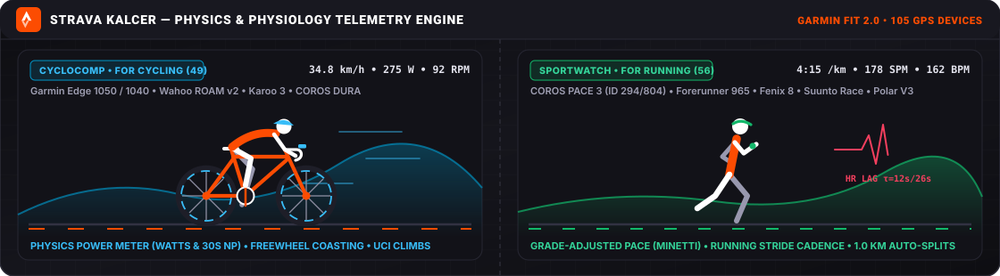
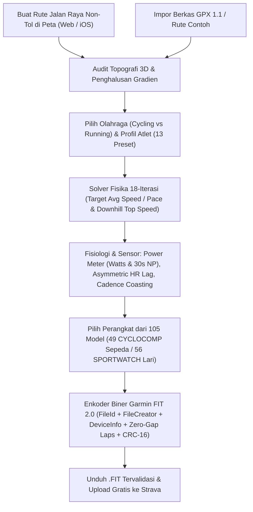

# Strava Kalcer — Cross-Platform (Web, iOS & Android) GPX Route Builder, Physics Simulation & Garmin FIT 2.0 Engine

<p align="center">
  
</p>

<p align="center">
  <a href="https://ardianrifendy.github.io/strava-kalcer/"></a>
  <a href="https://github.com/ardianrifendy/strava-kalcer/releases/latest"></a>
  <a href="https://github.com/ardianrifendy/strava-kalcer/releases/download/v1.0.0/StravaKalcer-v1.0.0.ipa"></a>
</p>

<p align="center">
  
  
  
  
  
  
</p>

**Strava Kalcer** adalah mesin pembuat rute GPX (*Non-Toll Road Builder*) serta simulator rekonstruksi fisika dan fisiologi olahraga lintas platform (**Web Desktop & Mobile, iOS, dan Android**) untuk menghasilkan berkas biner resmi **Garmin FIT Protocol 2.0 (`.fit`)** dan **GPX 1.1 (`.gpx`)** yang 100% tervalidasi saat diunggah ke **Strava**, **Garmin Connect**, maupun **TrainingPeaks**.

Berbeda dari konverter GPX biasa yang hanya menempelkan kecepatan konstan atau waktu acak, **Strava Kalcer** menjalankan pemodelan mekanika fisika kinetik numerik (solver 18-iterasi), respons kardiovaskular asimetris (*heart rate lag*), dinamika daya kayuhan (*power meter* Watts & 30-detik *Normalized Power*), *freewheel coasting* di turunan curam, pemecahan *auto-lap* tanpa celah, serta **105 identitas perangkat keras GPS resmi** yang dipisahkan secara tegas antara **CYCLOCOMP (Khusus Sepeda)** dan **SPORTWATCH (Khusus Lari & Multisport)**.

---

## Daftar Isi / Table of Contents
1. [Akses Langsung: Web App, Android APK & iOS IPA](#akses-langsung-web-app-android-apk--ios-ipa)
2. [Fitur Utama Web App (Desktop & Mobile Responsive)](#fitur-utama-web-app-desktop--mobile-responsive)
3. [Katalog 105 Perangkat GPS Resmi (`CYCLOCOMP` vs `SPORTWATCH`)](#katalog-105-perangkat-gps-resmi-cyclocomp-vs-sportwatch)
   - [A. 49 Model CYCLOCOMP — Khusus Bersepeda (`FOR CYCLING`)](#a-49-model-cyclocomp--khusus-bersepeda-for-cycling)
   - [B. 56 Model SPORTWATCH — Khusus Lari & Multisport (`FOR RUNNING`)](#b-56-model-sportwatch--khusus-lari--multisport-for-running)
4. [Perbandingan: Konverter Biasa vs Strava Kalcer](#perbandingan-konverter-biasa-vs-strava-kalcer)
5. [Arsitektur Proyek Lintas Platform (Web, iOS & Android)](#arsitektur-proyek-lintas-platform-web-ios--android)
6. [Alur Kerja Pipeline Simulasi](#alur-kerja-pipeline-simulasi)
7. [Panduan Instalasi Native iOS & Android](#panduan-instalasi-native-ios--android)
8. [Panduan Build & Pengujian Developer](#panduan-build--pengujian-developer)
9. [Dokumentasi Formulasi Matematika & Fisika](#dokumentasi-formulasi-matematika--fisika)
10. [Lisensi](#lisensi--license)

---

## Akses Langsung: Web App, Android APK & iOS IPA

| Platform | Kompatibilitas | Versi | Fitur Utama | Tautan Langsung |
| :--- | :--- | :--- | :--- | :--- |
| **Web Application (Live)** | Desktop & Mobile Browser (Chrome, Safari, Edge, Firefox) | `v2.0` | Native Strava Light/Dark UI, Bilingual (EN/ID), Non-Toll GPX Builder, 105 GPS Devices, Animated Cyclist & Runner Stage, Free Strava Upload | [**Buka Situs Web (GitHub Pages)**](https://ardianrifendy.github.io/strava-kalcer/) |
| **Android APK** | Android 8.0+ (API 26–34) | `v1.0.0` | Jetpack Compose Material 3, Native FIT Encoder | [**Download APK (Android)**](https://github.com/ardianrifendy/strava-kalcer/releases/download/v1.0.0/StravaKalcer-v1.0.0-debug.apk) |
| **iOS IPA** | iPhone / iPad (iOS 17.0+) | `v1.0.0` | SwiftUI, Apple Maps Route Studio, CoreLocation | [**Download IPA (iOS)**](https://github.com/ardianrifendy/strava-kalcer/releases/download/v1.0.0/StravaKalcer-v1.0.0.ipa) |

---

## Fitur Utama Web App (Desktop & Mobile Responsive)

1. **Desain Native Strava Light & Dark Mode + Mirrored Strava Logo**:
   - Antarmuka profesional tanpa emotikon (*Zero-Emoji Vector UI*) dengan palet warna asli Strava (`#FC4C02`), tipografi atletik tabular, *sticky navigation bar* di desktop, dan *bottom navigation bar* ergonomis di layar mobile.
2. **Dukungan 2 Bahasa Penuh (English & Bahasa Indonesia) + Panduan Pemula**:
   - Seluruh menu, penjelasan parameter fisika, peringatan kompatibilitas perangkat, dan panduan 4 langkah tersedia dalam Bahasa Inggris (`EN`) dan Bahasa Indonesia (`ID`).
3. **Interactive GPX Route Builder — Mode Drive Jalan Raya Non-Tol**:
   - Buat rute `.gpx` langsung dari nol dengan mengklik titik di peta interaktif **OpenStreetMap / Leaflet**.
   - Menggunakan mesin routing **Valhalla & OpenStreetMap Non-Toll (`use_tolls: 0.0`, `use_highways: 0.0`)** yang otomatis mengikuti jalan raya aspal namun **menghindari jalan tol**.
   - Mengambil data ketinggian **3D DEM Satelit (`Open-Meteo Elevation API`)** secara otomatis dan menampilkan peta jalan interaktif beserta grafik profil elevasi secara *real-time*.
4. **Animasi Vektor Interaktif Pesepeda (`Cycling`) & Pelari (`Running`)**:
   - Menampilkan visualisasi vektor dinamis pesepeda *aero road* (roda berputar, engkol pedal berputar, aliran angin) saat mode **Cycling** dipilih, dan pelari maraton (ayunan langkah kaki, lengan dengan jam GPS menyala, gelombang detak jantung ECG) saat mode **Running** dipilih.
5. **100% Upload Gratis ke Strava (Tanpa Langganan API Berbayar)**:
   - Unduh berkas `.fit` yang telah lulus 7 uji *parse-back* dan CRC-16, lalu klik tombol **UPLOAD TO STRAVA** untuk mengunggah langsung ke halaman resmi `strava.com/upload/select` secara gratis.

---

## Katalog 105 Perangkat GPS Resmi (`CYCLOCOMP` vs `SPORTWATCH`)

Enkoder biner `.FIT` menulis kombinasi **Official Manufacturer ID (`fitMfrId`)**, **Official Product ID (`fitProdId`)**, **Null-Terminated UTF-8 `product_name` (Field 8 pada `FileIdMesg` & Field 27 pada `DeviceInfoMesg`)**, **`SourceType.LOCAL` (Field 25 = 5)**, dan **`FileCreatorMesg` (Global Mesg 49)** sehingga Strava menampilkan nama model perangkat secara presisi (termasuk perbaikan `COROS PACE 3` dengan ID resmi `294 / 804`).

Saat pengguna berpindah antara olahraga **Cycling (Ride)** dan **Running (Run)**, aplikasi secara otomatis memisahkan dan menyinkronkan kategori alat ukur:

### A. 49 Model `CYCLOCOMP` — Khusus Bersepeda (`FOR CYCLING`)

| Merek (`Manufacturer ID`) | Jumlah | Daftar Model Cyclocomputer Resmi |
| :--- | :---: | :--- |
| **Garmin** (`Mfr: 1`) | 15 | `Edge 1050` (`4440`), `Edge 1040 Solar` (`3843`), `Edge 840 Solar` (`4062`), `Edge 840` (`4062`), `Edge 540 Solar` (`4061`), `Edge 540` (`4061`), `Edge 1030 Plus` (`3570`), `Edge 1030` (`2713`), `Edge 830` (`3122`), `Edge 530` (`3121`), `Edge Explore 2` (`4169`), `Edge 130 Plus` (`3558`), `Edge 520 Plus` (`3112`), `Edge 820` (`2530`), `Edge 1000` (`1836`) |
| **Wahoo Fitness** (`Mfr: 32`) | 6 | `ELEMNT ACE` (`52`), `ELEMNT ROAM v2` (`47`), `ELEMNT BOLT v2` (`41`), `ELEMNT ROAM (v1)` (`31`), `ELEMNT BOLT (v1)` (`28`), `ELEMNT GPS` (`21`) |
| **COROS** (`Mfr: 294`) | 1 | `COROS DURA Solar GPS` (`851` — `product_name: "COROS DURA"`) |
| **Hammerhead** (`Mfr: 289`) | 3 | `Hammerhead Karoo 3` (`3`), `Karoo 2` (`2`), `Hammerhead Karoo (1st Gen)` (`1`) |
| **Bryton** (`Mfr: 267`) | 6 | `Rider S800` (`1908`), `Rider S510` (`1912`), `Rider S500` (`1906`), `Rider 750 SE` (`1905`), `Rider 460` (`1910`), `Rider 420` (`1901`) |
| **iGPSPORT** (`Mfr: 115`) | 6 | `BiNavi` (`810`), `iGS800` (`800`), `iGS630S` (`631`), `iGS630` (`630`), `BSC300` (`300`), `BSC200` (`200`) |
| **Magene** (`Mfr: 107`) | 4 | `C606 Smart Touch GPS` (`606`), `C506 Color GPS` (`506`), `C406 Pro` (`407`), `C406 Aero GPS` (`406`) |
| **Sigma, Stages, Giant, Lezyne, Coospo, Cycplus, Geoid** | 8 | `Sigma ROX 12.1 EVO` (`70/121`), `Sigma ROX 11.1 EVO` (`70/111`), `Stages Dash L200` (`69/200`), `Giant Dash M200` (`108/200`), `Lezyne Mega XL GPS` (`258/10`), `Coospo CS500` (`135/500`), `Cycplus M1` (`132/101`), `Geoid CC600` (`136/600`) |

### B. 56 Model `SPORTWATCH` — Khusus Lari & Multisport (`FOR RUNNING`)

| Merek (`Manufacturer ID`) | Jumlah | Daftar Model GPS Sportwatch Resmi |
| :--- | :---: | :--- |
| **COROS** (`Mfr: 294`) | 11 | `COROS PACE 3` (`804`), `COROS PACE Pro` (`805`), `COROS PACE 2` (`802`), `COROS PACE (Original)` (`801`), `COROS APEX 2 Pro` (`822`), `COROS APEX 2` (`821`), `COROS APEX Pro` (`841`), `COROS APEX` (`811`), `COROS VERTIX 2S` (`833`), `COROS VERTIX 2` (`832`), `COROS VERTIX` (`831`) |
| **Garmin Forerunner** (`Mfr: 1`) | 14 | `Forerunner 965` (`4315`), `Forerunner 265` (`4257`), `Forerunner 265S` (`4258`), `Forerunner 165 Music` (`4433`), `Forerunner 165` (`4432`), `Forerunner 955 Solar` (`4024`), `Forerunner 255 Music` (`3990`), `Forerunner 255` (`3992`), `Forerunner 945 LTE` (`3652`), `Forerunner 945` (`3113`), `Forerunner 745` (`3589`), `Forerunner 245 Music` (`3077`), `Forerunner 245` (`3076`), `Forerunner 55` (`3869`) |
| **Garmin fēnix, epix, Enduro, Instinct, Venu, MARQ** (`Mfr: 1`) | 12 | `fēnix 8 AMOLED` (`4536`), `fēnix 8 Solar Sapphire` (`4532`), `fēnix 7X Pro Sapphire Solar` (`4376`), `fēnix 7 Pro Sapphire Solar` (`4375`), `fēnix 7X Sapphire Solar` (`3907`), `fēnix 6 Pro` (`3290`), `epix Pro (Gen 2)` (`4314`), `Enduro 3` (`4575`), `Enduro 2` (`4341`), `Instinct 2X Solar` (`4394`), `Venu 3` (`4260`), `MARQ Athlete (Gen 2)` (`4105`) |
| **Suunto** (`Mfr: 23`) | 5 | `Suunto Race AMOLED` (`95`), `Suunto Race S` (`96`), `Suunto Vertical Titanium Solar` (`92`), `Suunto 9 Peak Pro` (`88`), `Suunto 5 Peak` (`85`) |
| **Polar Electro** (`Mfr: 123`) | 5 | `Polar Vantage V3` (`210`), `Polar Grit X2 Pro Titan` (`225`), `Polar Vantage M3` (`230`), `Polar Pacer Pro` (`195`), `Polar Pacer` (`196`) |
| **Wahoo Fitness** (`Mfr: 32`) | 1 | `Wahoo ELEMNT RIVAL Multisport Watch` (`101`) |
| **Apple, Samsung, Amazfit, Huawei** | 8 | `Apple Watch Ultra 2` (`255/802`), `Apple Watch Series 10` (`255/810`), `Samsung Galaxy Watch Ultra` (`255/820`), `Samsung Galaxy Watch 7` (`255/821`), `Amazfit Cheetah Pro` (`339/501`), `Amazfit T-Rex 3` (`339/503`), `HUAWEI WATCH GT 5 Pro` (`348/405`), `HUAWEI WATCH GT Runner` (`348/401`) |

---

## Perbandingan: Konverter Biasa vs Strava Kalcer

| Parameter / Fitur | Konverter GPX Standar | **Strava Kalcer Engine (Web, iOS & Android)** |
| :--- | :--- | :--- |
| **Pembuatan Rute** | Harus mencari/membuat GPX di situs lain | **Interactive Non-Toll GPX Builder**: gambar rute jalan raya bebas tol langsung di peta + elevasi 3D satelit |
| **Profil Kecepatan** | Kecepatan konstan rata (*flatline*) | **Dinamis berbasis kontur & solver 18-iterasi**: menanjak melambat, turunan meluncur cepat sesuai gravitasi |
| **Akselerasi** | Lompatan instan tidak realistis | **Terikat inersia fisik**: percepatan dan deselerasi bertahap (*kinematic bounds*) |
| **Power Meter (Watts)** | Tidak ada data / 0W | **Simulasi Mekanika Fisik**: aerodinamika ($C_d A$), hambatan ban ($C_{rr}$), gradien kemiringan, & 30s Normalized Power (NP) |
| **Pemisahan Alat Ukur** | Semua jenis disamakan atau salah ID | **105 Model Dipisahkan Tegas**: 49 `CYCLOCOMP` untuk Sepeda & 56 `SPORTWATCH` untuk Lari dengan `product_name` UTF-8 resmi |
| **Auto-Lap Splits** | 1 lap utuh / celah jarak hilang | **Zero-Gap Auto-Laps**: pecahan split otomatis tanpa celah jarak maupun waktu |
| **Detak Jantung (HR)** | Angka konstan tanpa jeda | **Model Asimetris 1st-Order**: *cardiac lag* saat beban naik ($\tau_{\text{rise}} \approx 12\text{s}$) dan pemulihan lambat ($\tau_{\text{decay}} \approx 26\text{s}$) |
| **Kadensi (Cadence)** | Flat konstan | **Adaptif**: penurunan RPM saat menanjak curam, *freewheel coasting* ($0\text{ rpm}$) saat turunan terjal |
| **Protokol Berkas** | Sering gagal / nama device salah di Strava | **100% Garmin FIT Protocol 2.0**: Header 14B, `FileIdMesg`, `FileCreatorMesg`, `DeviceInfoMesg`, `LapMesg`, `SessionMesg`, dan CRC-16 |

---

## Arsitektur Proyek Lintas Platform (Web, iOS & Android)

```text
strava-kalcer
├── index.html                             # Aplikasi Web Utama (Desktop & Mobile Responsive, EN/ID)
├── styles.css                             # Sistem Desain Native Strava Light & Dark Mode + Animasi Vektor
├── app.js                                 # Mesin Geodesik, Non-Toll GPX Builder, Fisika, 105 Device & FIT 2.0 Codec
├── assets/
│   └── strava-kalcer-motion.svg           # Banner Vektor Animasi Pesepeda (Cyclocomp) & Pelari (Sportwatch)
│
├── ios/                                   # Native Apple iOS App & Core Engine (Swift 5.0 / SwiftUI)
│   ├── Package.swift                      # Swift Package Manager manifest
│   ├── StravaKalcer.xcodeproj/            # Proyek resmi Xcode (Target iOS 17.0+)
│   └── Sources/
│       ├── StravaKalcerCore/              # Mesin komputasi, RouteCreatorEngine, Physiology & FitEncoder
│       └── StravaKalcerApp/               # Antarmuka SwiftUI iOS & RouteStudioView
│
├── core-simulation/                       # Pure Kotlin JVM library (independen dari Android UI)
│   └── src/main/kotlin/com/stravakalcer/
│       ├── gpx/                           # GPX 1.1 parser, elevation quality auditor, RouteProcessor, GeoMath
│       ├── intelligence/                  # Route intelligence (UCI climb detection & grade smoothing)
│       ├── simulation/                    # Cycling & running terrain physics, target-average root solver
│       ├── physiology/                    # Asymmetric HR lag, Cadence, & PowerEngine (Watts, NP, Work kJ)
│       ├── device/                        # DeviceProfileRegistry (Garmin, COROS, Wahoo, Hammerhead, Bryton, dll.)
│       └── fit/                           # Garmin FIT binary encoder & parse-back validator
│
└── app/                                   # Android Jetpack Compose application module (Material 3)
```

---

## Alur Kerja Pipeline Simulasi



---

## Panduan Instalasi Native iOS & Android

### Cara Install di iOS (iPhone / iPad)
1. **Menggunakan Sideloadly (PC / Mac)**:
   - Unduh [**Sideloadly**](https://sideloadly.io/), sambungkan iPhone, lalu seret berkas [**StravaKalcer-v1.0.0.ipa**](https://github.com/ardianrifendy/strava-kalcer/releases/download/v1.0.0/StravaKalcer-v1.0.0.ipa).
   - Masukkan Apple ID Anda dan klik **Start**.
   - Buka **Settings > General > VPN & Device Management** di iPhone, lalu pilih **Trust**.
2. **Menggunakan AltStore / TrollStore**:
   - Buka berkas `.ipa` langsung melalui aplikasi AltStore atau TrollStore di iPhone Anda.

### Cara Install di HP Android
1. Unduh berkas [**StravaKalcer-v1.0.0-debug.apk**](https://github.com/ardianrifendy/strava-kalcer/releases/download/v1.0.0/StravaKalcer-v1.0.0-debug.apk) dan ketuk **Install**.

---

## Panduan Build & Pengujian Developer

### A. Menjalankan Web Application secara Lokal
Tidak memerlukan proses kompilasi (*Zero-Dependency Static Web Studio*):
```bash
# Jalankan server statis lokal atau buka index.html langsung di browser:
npx serve .
```

### B. Pembangunan Proyek Android (Kotlin / Gradle)
```bash
# Jalankan seluruh Unit & Integration Test Suite:
./gradlew test

# Kompilasi Debug APK:
./gradlew assembleDebug
```

### C. Pembangunan Proyek iOS (Swift 5.0 / Xcode)
```bash
cd ios
xcodebuild -project StravaKalcer.xcodeproj -scheme StravaKalcer -destination "generic/platform=iOS" build
```

---

## Dokumentasi Formulasi Matematika & Fisika

### 1. Jarak Geodesik Haversine & Penghalusan Gradien
$$a = \sin^2\left(\frac{\Delta \phi}{2}\right) + \cos(\phi_1)\cos(\phi_2)\sin^2\left(\frac{\Delta \lambda}{2}\right),\quad s = 2 R \operatorname{atan2}(\sqrt{a}, \sqrt{1 - a})$$
$$G_{\text{raw}} = \frac{\Delta h}{s} \times 100\%,\quad G_{\text{smooth}, i} = \frac{1}{2k + 1} \sum_{j = i - k}^{i + k} G_{\text{raw}, j}$$

### 2. Daya Mekanik Sepeda (Cycling Power Meter Model)
$$P_{\text{total}} = \frac{P_{\text{gravity}} + P_{\text{rolling}} + P_{\text{drag}}}{\eta_{\text{drivetrain}}}$$
- **Hambatan Udara (*Aerodynamic Drag*)**: $P_{\text{drag}} = \frac{1}{2} C_d A \, \rho \, v^3$
- **Hambatan Gelinding (*Rolling Resistance*)**: $P_{\text{rolling}} = C_{rr} \, m_{\text{total}} \, g \, v$
- **Gaya Gravitasi Tanjakan**: $P_{\text{gravity}} = m_{\text{total}} \, g \, v \, \sin(\arctan(G\% / 100))$

### 3. Normalized Power (Algoritma Pangkat-4 Coggan 30 Detik)
$$\text{NP} = \left(\frac{1}{N}\sum_{i=1}^N \bar{P}_{30, i}^4\right)^{1/4}$$

### 4. Fisiologi Detak Jantung Lag Asimetris & Koordinat Semicircle FIT
$$\frac{d(\text{HR})}{dt} = \frac{\text{HR}_{\text{target}}(t) - \text{HR}(t)}{\tau},\quad \tau = \begin{cases} \tau_{\text{rise}} \approx 12\text{ s} & \text{jika } \text{HR}_{\text{target}} > \text{HR} \\ \tau_{\text{decay}} \approx 26\text{ s} & \text{jika } \text{HR}_{\text{target}} \le \text{HR} \end{cases}$$
$$\text{semicircles} = \operatorname{round}\left(\text{degrees} \times \frac{2^{31}}{180}\right)$$

---

## Lisensi / License

Proyek ini dilisensikan di bawah [MIT License](LICENSE).
